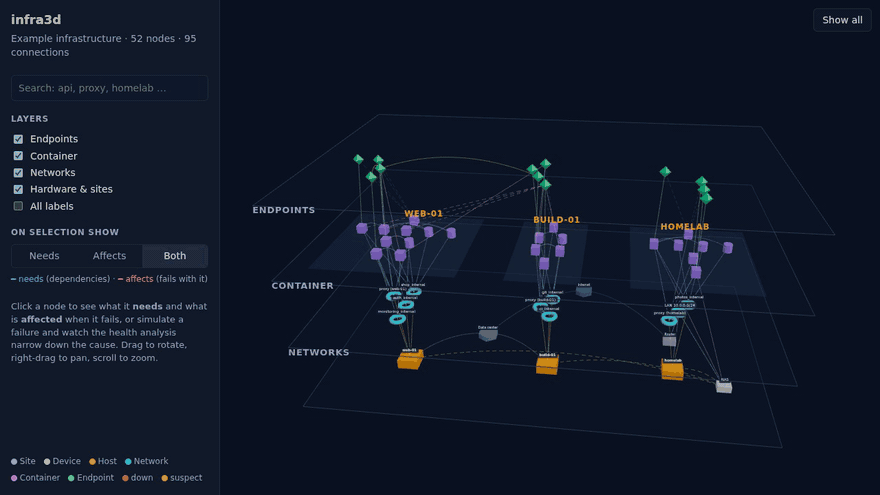
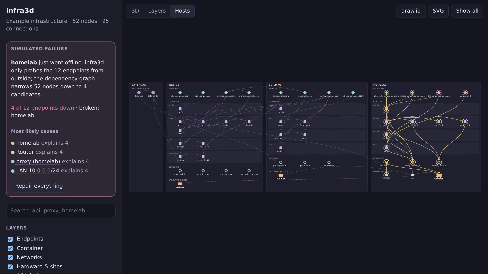
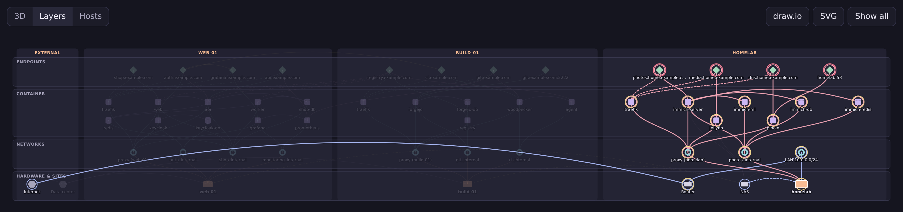
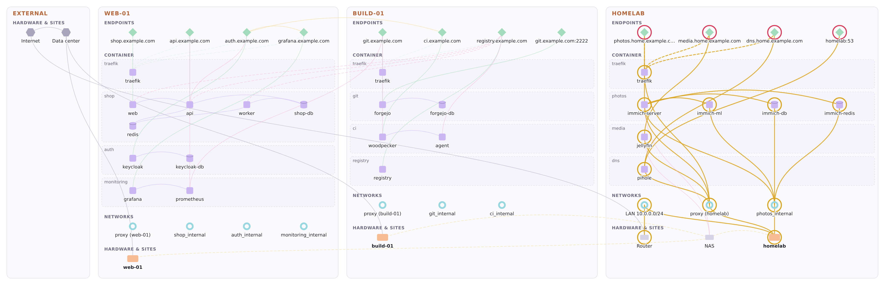

# infra3d

[](https://github.com/SurfaceScratcher/infra3d/actions/workflows/ci.yml)

See how your infrastructure hangs together. infra3d reads your Docker Compose stacks, checks
every endpoint and shows hosts, networks, containers and endpoints as stacked 3D layers you can
rotate, zoom and click through.

- **No drawing, no scanning:** the topology comes straight from your compose files (plain stack
  folders or an Ansible repository), including reverse proxy routes, published ports and `depends_on`.
- **Root-cause hints:** when endpoints fail, the dependency graph narrows the failure down to the
  containers, networks or hosts that can explain it, and tells you when the fault must be in the
  service itself.
- **Dependencies and impact:** select a node to highlight what it **needs** (blue) and what
  **fails with it** (red).
- **2D views and wiki export:** switch to a flat diagram per layer or per host, download it as an
  editable draw.io file or embed a live, always current picture in XWiki, Confluence or any wiki.
- **Notifications** via ntfy or a webhook when something goes down or recovers.
- Runs as a **Docker container** (amd64 and arm64), or embed the **React component** in your own app.



**[Live demo](https://surfacescratcher.github.io/infra3d/)** · [Library docs](packages/infra3d) · [Importer](packages/import-compose) · [Contributing](CONTRIBUTING.md)

## Self-hosted app

```yaml
# docker-compose.yml
services:
  infra3d:
    image: ghcr.io/surfacescratcher/infra3d:latest
    restart: unless-stopped
    ports:
      - "8080:8080"
    extra_hosts:
      - "host.docker.internal:host-gateway"   # to check ports on this host
    volumes:
      - /opt/stacks:/stacks:ro     # one folder per stack, or per host and stack
      - ./config:/config:ro        # optional: config/infra3d.config.json
    environment:
      NTFY_URL: https://ntfy.sh/my-homelab   # optional
```

`docker compose up -d`, then open http://localhost:8080. The layout is detected: a single
`compose.yaml`, one folder per stack (Dockge, Komodo), one folder per host and stack, or the root of
an Ansible repository. Routes come from Traefik, Caddy (caddy-docker-proxy) and nginx-proxy; for
anything else, add [`checks`](packages/import-compose#config) to the config.
All options are in [apps/app](apps/app#configuration). The UI shows your whole infrastructure, so
keep it on your LAN or protect it with `INFRA3D_AUTH` or your reverse proxy's login, see
[Security](apps/app#security). Read-only, no telemetry, no Docker socket needed.

## 2D views

Next to the 3D scene, the app shows two flat diagrams of the same topology with the same selection,
highlighting and live status. **Hosts** puts each host on a card with its compose stacks as boxes:



**Layers** keeps one band per layer and one column per host, so everything that belongs to a host
lines up underneath it. Here the homelab host is selected: red is what fails with it, blue what it needs.



For documentation, the **draw.io** button downloads both views as an editable draw.io file for the
draw.io macro in XWiki or Confluence. To keep a wiki page up to date instead, embed the live image
the app serves at `/api/diagram.svg`. It has a light theme for white pages and shows the current status:



```
[[image:https://infra3d.example.com/api/diagram.svg?view=hosts&token=<INFRA3D_EMBED_TOKEN>]]
```

See [embedding the diagram in a wiki](apps/app#embedding-the-diagram-in-a-wiki) for the token and the options.

## React component

```bash
npm install infra3d three @react-three/fiber @react-three/drei
```

```tsx
import { useState } from 'react';
import { InfraScene } from 'infra3d';
import topology from './topology.json';

export function Infra() {
  const [selected, setSelected] = useState<string | null>(null);
  return (
    <div style={{ height: 600 }}>
      <InfraScene topology={topology} selectedId={selected} onSelect={setSelected} />
    </div>
  );
}
```

For the 2D views without three.js, use `InfraDiagram` from `infra3d/diagram`
(`<InfraDiagram view="hosts" topology={topology} />`), see the [library docs](packages/infra3d#infradiagram-2d-views).

Generate `topology.json` from your compose stacks:

```bash
npx infra3d-import-compose ./stacks -o topology.json
```

## Packages

| Package | |
| --- | --- |
| [`infra3d`](packages/infra3d) | The scene component, plus `infra3d/core` with the data model, validation, layout and health analysis (no React needed) |
| [`infra3d-import-compose`](packages/import-compose) | CLI and API that build a topology from Docker Compose files, plain directories or an Ansible inventory |
| [`infra3d-import-ci`](packages/import-ci) | Experimental: CI pipelines, workflows and steps from Woodpecker or Drone as a second domain |
| [`apps/app`](apps/app) | The self-hosted app (Docker image) and the live demo |

## Development

```bash
npm install
npm run dev     # demo with the example topology
npm test
```

See [CONTRIBUTING.md](CONTRIBUTING.md) for the architecture and how to add an importer.

## Acknowledgements

infra3d is built on [three.js](https://github.com/mrdoob/three.js),
[React Three Fiber](https://github.com/pmndrs/react-three-fiber) and [drei](https://github.com/pmndrs/drei)
by Poimandres, [camera-controls](https://github.com/yomotsu/camera-controls), [React](https://react.dev)
and [yaml](https://github.com/eemeli/yaml). Developed with Vite, Vitest, TypeScript and Changesets. Thank you to everyone behind them.

The app's web bundle ships the licenses of everything it includes in `THIRD_PARTY_LICENSES.md`,
linked at the bottom of the UI.

## How this was built

infra3d was written with [Claude Code](https://claude.com/claude-code), Anthropic's AI coding
agent. I came up with the idea, made the design decisions, reviewed the changes and run it
against my own homelab every day. The test suite, CI and the [security notes](apps/app#security)
are there so you don't have to take that on trust. Questions about how something works are
welcome in [Discussions](https://github.com/SurfaceScratcher/infra3d/discussions).

## License

[MIT](LICENSE)
