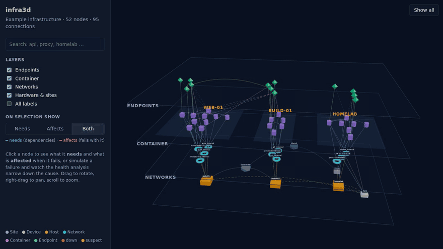

# infra3d

[](https://github.com/SurfaceScratcher/infra3d/actions/workflows/ci.yml)

See how your infrastructure hangs together. infra3d reads your Docker Compose stacks, checks
every endpoint and shows hosts, networks, containers and endpoints as stacked 3D layers you can
rotate, zoom and click through.

- **No drawing, no scanning:** the topology comes straight from your compose files (plain stack
  folders or an Ansible repository), including Traefik routes, published ports and `depends_on`.
- **Root-cause hints:** when endpoints fail, the dependency graph narrows the failure down to the
  containers, networks or hosts that can explain it, and tells you when the fault must be in the
  service itself.
- **Dependencies and impact:** select a node to highlight what it **needs** (blue) and what
  **fails with it** (red).
- **Notifications** via ntfy or a webhook when something goes down or recovers.
- Runs as a **Docker container** (amd64 and arm64), or embed the **React component** in your own app.



**[Live demo](https://surfacescratcher.github.io/infra3d/)** · [Library docs](packages/infra3d) · [Importer](packages/import-compose) · [Contributing](CONTRIBUTING.md)

## Self-hosted app

```yaml
# docker-compose.yml
services:
  infra3d:
    image: ghcr.io/surfacescratcher/infra3d:latest
    restart: unless-stopped
    ports:
      - "8080:8080"
    volumes:
      - ./stacks:/stacks:ro        # stacks/<host>/<stack>/compose.yaml
      - ./config:/config:ro        # optional: config/infra3d.config.json
    environment:
      NTFY_URL: https://ntfy.sh/my-homelab   # optional
```

`docker compose up -d`, then open http://localhost:8080. Mount the root of an Ansible repository
(with `inventory/` and `stacks/`) at `/stacks` instead and it is detected automatically.
All options are in [apps/app](apps/app#configuration).

## React component

```bash
npm install infra3d three @react-three/fiber @react-three/drei
```

```tsx
import { useState } from 'react';
import { InfraScene } from 'infra3d';
import topology from './topology.json';

export function Infra() {
  const [selected, setSelected] = useState<string | null>(null);
  return (
    <div style={{ height: 600 }}>
      <InfraScene topology={topology} selectedId={selected} onSelect={setSelected} />
    </div>
  );
}
```

Generate `topology.json` from your compose stacks:

```bash
npx infra3d-import-compose ./stacks -o topology.json
```

## Packages

| Package | |
| --- | --- |
| [`infra3d`](packages/infra3d) | The scene component, plus `infra3d/core` with the data model, validation, layout and health analysis (no React needed) |
| [`infra3d-import-compose`](packages/import-compose) | CLI and API that build a topology from Docker Compose files, plain directories or an Ansible inventory |
| [`apps/app`](apps/app) | The self-hosted app (Docker image) and the live demo |

## Development

```bash
npm install
npm run dev     # demo with the example topology
npm test
```

See [CONTRIBUTING.md](CONTRIBUTING.md) for the architecture and how to add an importer.

## License

[MIT](LICENSE)
