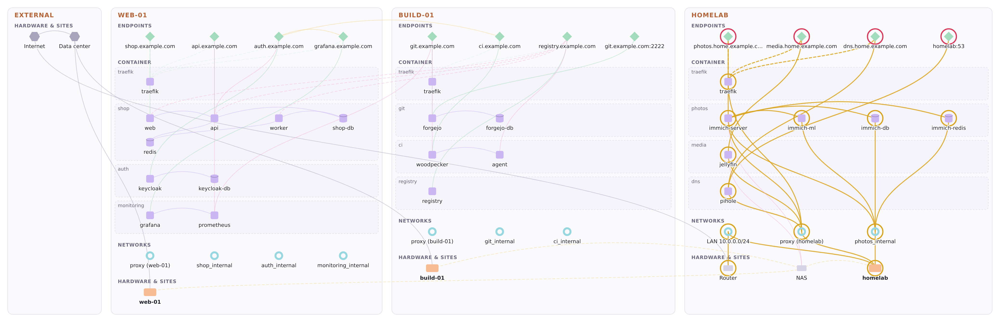

# infra3d app

Self-hosted infra3d: imports your Docker Compose stacks, checks every endpoint and serves the
3D view with root-cause hints. Image: `ghcr.io/surfacescratcher/infra3d` (amd64, arm64).

```bash
docker run -d -p 8080:8080 -v ./stacks:/stacks:ro ghcr.io/surfacescratcher/infra3d:latest
```

A complete compose file is in [examples/docker-compose.yml](../../examples/docker-compose.yml).

The UI switches between the 3D scene and two 2D diagrams (*Layers*, *Hosts*); *draw.io* and
*SVG* download the diagram for documentation, see [2D views](../../README.md#2d-views).

*Open…* (or dropping a file on the page) shows any topology file instead, also of other domains:
a file that carries its [profile](../../packages/infra3d#domain-profiles), such as the output of
[infra3d-import-ci](../../packages/import-ci), brings its own shapes, colours and wording, and
the status its nodes report. The file is read in the browser and never sent to the server; the
health simulation is only offered for topologies with check targets.

## How it works

1. Every interval the server reads the topology: it imports the compose files below `/stacks`
   with [infra3d-import-compose](../../packages/import-compose), or loads a ready-made topology
   file. A broken import keeps the last good topology and shows the error in the UI.
2. It probes every endpoint: HTTP(S) URLs with a request (redirects, 401 and 403 count as up,
   5xx and Traefik's "404 page not found" as down), `tcp://host:port` with a connect.
   An endpoint counts as down after two failures in a row and as up again right away.
3. `analyzeHealth()` from [infra3d](../../packages/infra3d) derives suspects and likely causes
   from the dependency graph.
4. Changes go to ntfy and/or a webhook.

Probes run from inside the container. Endpoints that are only reachable from your LAN need a
network the container can reach them from (the default bridge network usually works). For a single
host, published ports are checked on `host.docker.internal`, see the compose example.

Services behind Nginx Proxy Manager, a Cloudflare tunnel or anything else the importer cannot see
get their checks from `checks` in `infra3d.config.json`:

```json
{ "checks": { "jellyfin": "https://media.example.com", "homeassistant": "tcp://192.168.1.10:8123" } }
```

## Configuration

| Variable | Default | |
| --- | --- | --- |
| `INFRA3D_STACKS` | `/stacks` | compose stacks: a single `compose.yaml`, `<stack>/compose.yaml`, `<host>/<stack>/compose.yaml`, or an Ansible repository |
| `INFRA3D_HOST` | `host` | name of the host when all stacks run on one machine |
| `INFRA3D_HOST_ADDRESS` | `host.docker.internal` | where TCP checks of a single host's published ports go; needs `extra_hosts: ["host.docker.internal:host-gateway"]` |
| `INFRA3D_SOURCE` | `auto` | `directory`, `ansible` or `auto` (Ansible if `inventory/host_vars` exists) |
| `INFRA3D_CONFIG` | `/config/infra3d.config.json` | optional hosts, sites, uplinks and special cases, see [the importer](../../packages/import-compose#config) |
| `INFRA3D_TOPOLOGY` | | path to a ready-made topology JSON; skips the import |
| `INFRA3D_INTERVAL` | `60` | seconds between checks (and topology reloads) |
| `INFRA3D_CONFIRM_FAILS` | `2` | failures in a row before an endpoint counts as down |
| `INFRA3D_TIMEOUT` | `10` | seconds per probe |
| `NTFY_URL` | | e.g. `https://ntfy.sh/my-homelab` |
| `NTFY_TOKEN` | | access token for a protected ntfy topic |
| `WEBHOOK_URL` | | receives `{ event: "down" \| "up", title, message, endpoints, causes, url }` as JSON |
| `INFRA3D_BASE_URL` | | public URL of the app, used as the click target in notifications |
| `INFRA3D_AUTH` | | `user:password` for HTTP Basic Auth on UI and API (`/healthz` stays open) |
| `INFRA3D_EMBED_TOKEN` | | opens only `/api/diagram.svg` and `/api/diagram.drawio` to requests with `?token=<value>`, for diagrams embedded in a wiki |
| `PORT` | `8080` | |

Self-signed certificates: set `NODE_TLS_REJECT_UNAUTHORIZED=0` to accept them.

## Security

The UI shows your whole infrastructure: hosts, containers, internal networks, domains and which
of them are down. Do not expose it to the internet without protection. Either set `INFRA3D_AUTH`
or put it behind the authentication of your reverse proxy (Authelia, Authentik, Cloudflare Access …).

- The stacks are mounted read-only and the importer never copies environment values, secrets
  or volumes into the topology. Only structure is kept: services, images, networks, routes, ports.
- infra3d makes no outgoing requests besides your own health checks and notifications.
  No telemetry, no update checks.
- The container runs as an unprivileged user and needs no Docker socket.

## API

- `GET /api/state`: topology, check results, status per node, failed endpoints, suspects and causes
- `POST /api/check`: re-read the topology and check now
- `GET /api/report`: the last import as an anonymized report for bug reports (also linked as
  "import report" at the bottom of the sidebar), see [import reports](../../packages/import-compose#import-reports-for-bug-reports)
- `GET /api/diagram.svg`: the current 2D diagram with live status as an SVG image.
  Query: `view=hosts|layers` (default `hosts`), `theme=light|dark` (default `light`),
  `hide=network,endpoint` to leave out layers, `status=0` without health state
- `GET /api/diagram.drawio`: both 2D views as an editable draw.io file, same `theme`, `hide` and `status`
- `GET /healthz`: liveness

### Embedding the diagram in a wiki



The SVG endpoint always shows the current state, so a wiki page that embeds it stays up to date.
The image is loaded by each reader's browser, so it needs the readers to reach infra3d and pass
its authentication. With `INFRA3D_AUTH` set, add `INFRA3D_EMBED_TOKEN` and put the token in the URL;
it opens the two diagram endpoints and nothing else:

```
# XWiki 2.1 syntax
[[image:https://infra3d.example.com/api/diagram.svg?view=hosts&token=<token>]]
```

Everyone who can read the page can see the token and therefore the diagram (structure, names and
which endpoints are down, but not the rest of the API). Use a long random value, e.g.
`openssl rand -hex 24`, and change it if the page becomes more widely readable.
For an editable copy instead of a live picture, download the draw.io file (button in the app or
`/api/diagram.drawio`) and import it into the draw.io macro.

## Development

```bash
npm run build -w infra3d -w infra3d-import-compose
INFRA3D_STACKS=../../packages/import-compose/test/fixtures/directory npm run dev -w @infra3d/app
```

This starts the server on :8080 and Vite with a proxy to it. `npm run dev:demo -w @infra3d/app`
runs the static demo without a server instead.
