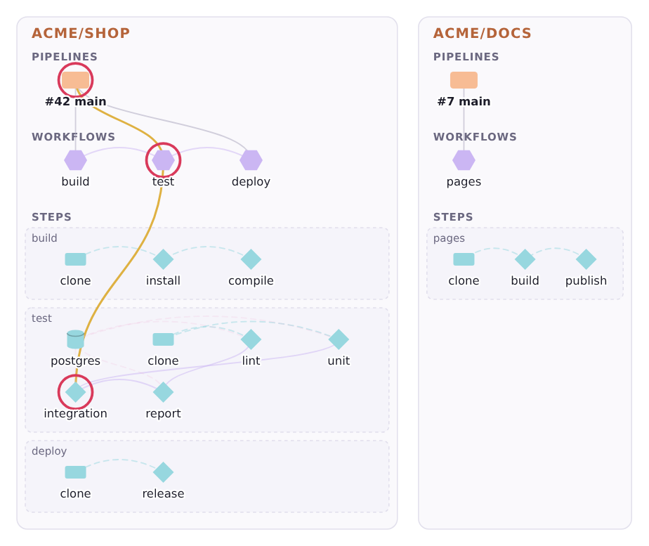

# infra3d-import-ci

Shows CI pipelines from [Woodpecker](https://woodpecker-ci.org) and [Drone](https://www.drone.io)
as a layered graph: pipelines on top, workflows (Drone: stages) below them, steps at the bottom,
with the `depends_on` links between workflows and between steps. Click a failed step to see what
it blocked, or a red pipeline to see why it failed.

> Experimental and not published to npm yet. It is the second domain next to infrastructure and
> tests the [domain profiles](../infra3d#domain-profiles) of infra3d.



## CLI

The connection comes from the same variables the CI's own CLI uses. The token is a personal
access token from your user profile in the CI's web UI.

```sh
export DRONE_SERVER=https://drone.example.com DRONE_TOKEN=...            # Drone
export WOODPECKER_SERVER=https://ci.example.com WOODPECKER_TOKEN=...     # or Woodpecker

npx infra3d-import-ci -f svg -o pipelines.svg              # every active repository
npx infra3d-import-ci -r acme/shop -n 3 -f drawio -o shop.drawio
npx infra3d-import-ci -f snapshot -o snapshot.json         # the fetched runs, to replay later
npx infra3d-import-ci --from snapshot.json -f json -o topology.json
```

| Option | |
| --- | --- |
| `-s, --source` | `woodpecker` or `drone` (default: whichever variables are set) |
| `-r, --repo <owner/name>` | repository to read; repeat for more (default: all active ones) |
| `-n, --pipelines <n>` | latest pipelines per repository (default 1) |
| `-b, --branch <name>` | only this branch, `*` for any (default: the repository's default branch) |
| `-f, --format` | `json` (topology), `svg`, `drawio` or `snapshot` |
| `--view` | `hosts` (one card per repository, default) or `layers`, for SVG |
| `--dark` | dark colours, for SVG |
| `--from <file>` | build from a snapshot instead of the API |

The JSON topology carries the CI profile and each node's status, so the [infra3d app](../../apps/app)
and the live demo show it with *Open…* (or drag and drop) without further setup, in 3D or 2D.

Keep the token in the environment, not on the command line. The output contains repository
names, branches, commit messages and authors, so treat it like the CI itself.

## The graph

| Layer | Woodpecker | Drone | Column / group |
| --- | --- | --- | --- |
| Pipelines | pipeline | build | repository |
| Workflows | workflow (one per config file) | stage (one per `kind: pipeline`) | repository |
| Steps | step, service | step, detached step (service) | repository, grouped by workflow |

| Edge | From → to |
| --- | --- |
| `contains` | pipeline → workflow |
| `runs` | workflow → step (implied by the workflow box in the hosts view) |
| `needs` | workflow → workflow and step → step, from `depends_on` |
| `after` | step → previous step, for workflows without `depends_on` (they run in order); with `depends_on`, steps without it start after the clone |
| `uses` | step → service of the same workflow |

States become node status: `success` is ok; `failure`, `error` and `killed` are down; everything
else (running, pending, skipped, blocked, …) is unknown. Each node keeps its state, duration,
exit code and a link to the CI's web UI in `meta`.

## API

Each source translates its API into one neutral model (`CiSnapshot`); the graph is built from
that alone, so another CI only needs another source.

```ts
import { drone, buildTopology } from 'infra3d-import-ci';
import { InfraDiagram } from 'infra3d';

const snapshot = await drone.fetchSnapshot({ server, token, repos: ['acme/shop'], pipelines: 3 });
const topology = buildTopology(snapshot);

// The topology carries CI_PROFILE and each node its status, so nothing else is needed
<InfraDiagram topology={topology} view="hosts" />
```

`fromWoodpecker` and `fromDrone` translate single API responses, e.g. from a webhook.

## License

MIT
