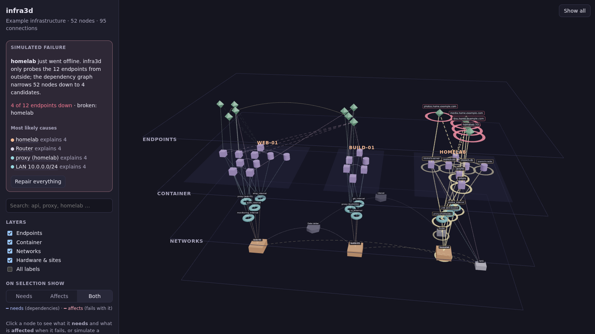
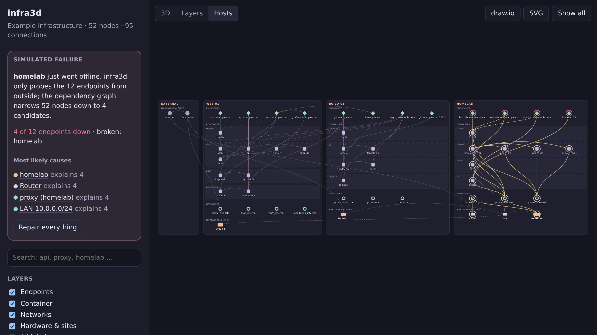
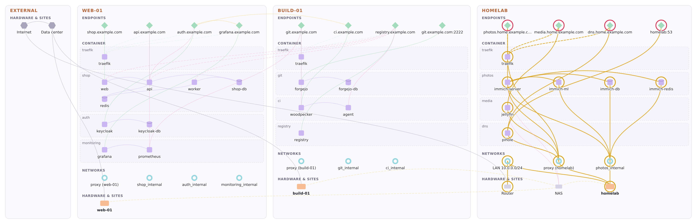

# infra3d

React component that shows IT infrastructure as stacked 3D layers
(hardware → networks → containers → endpoints) you can rotate, zoom and click through,
plus two 2D diagrams of the same topology that export to draw.io.



**[Live demo](https://surfacescratcher.github.io/infra3d/)** · [Repository](https://github.com/SurfaceScratcher/infra3d)

```bash
npm install infra3d three @react-three/fiber @react-three/drei
```

Requires React 19, `@react-three/fiber` 9 and `@react-three/drei` 10.

## `<InfraScene>`

```tsx
import { InfraScene, type Topology } from 'infra3d';

<div style={{ height: 600 }}>
  <InfraScene
    topology={topology}
    selectedId={selected}
    onSelect={setSelected}
    mode="both"
    hiddenLayers={['network']}
    status={health?.status}
    theme={{ background: '#11111b' }}
  />
</div>
```

The scene fills its parent, so give the parent a height.

| Prop | Type | |
| --- | --- | --- |
| `topology` | `Topology` | required; keep the object stable, a new object re-runs the layout |
| `selectedId` | `string \| null` | highlighted node; the camera flies to it |
| `onSelect` | `(id \| null) => void` | click on a node, or `null` on empty space |
| `mode` | `'deps' \| 'impact' \| 'both'` | which direction to highlight, default `both` |
| `hiddenLayers` | `string[]` | layer ids to hide |
| `profile` | `DomainProfile` | node shapes, edge styles and how failures travel, default `INFRA_PROFILE` (see [Domain profiles](#domain-profiles)) |
| `showAllLabels` | `boolean` | label every node, also those the profile labels only on hover (containers, endpoints) |
| `status` | `Record<id, 'ok' \| 'down' \| 'suspect' \| 'unknown'>` | failed nodes pulse red, suspects are orange |
| `theme` | `Partial<InfraTheme>` | colours and font, merged into `DEFAULT_THEME` |
| `layout` | `LayoutOptions` | spacing and the anchor layer |
| `cameraAngle` | `{ azimuth, polar }` | viewing angle of the overview in radians, default slightly from the right and above |
| `ref` | `Ref<InfraSceneHandle>` | `ref.current.fitAll()` moves the camera back to the overview |

The overview always shows the whole scene: the camera distance follows from the scene size and
the aspect ratio of the container, so narrow phone screens move the camera back instead of
cutting off the sides. Resizes and topology updates refit the view until the user moves the camera.

```tsx
const scene = useRef<InfraSceneHandle>(null);

<button onClick={() => scene.current?.fitAll()}>Show all</button>
<InfraScene ref={scene} topology={topology} />
```

## `<InfraDiagram>`: 2D views

The same topology as a flat SVG diagram, in two views:



- `view="layers"`: one band per layer (endpoints, containers, networks, hardware) and one strip per
  host, so everything that belongs to a host lines up underneath it.
- `view="hosts"`: one card per host with its endpoints, its compose stacks as boxes, its networks
  and its hardware. Network memberships are implied by the cards and drawn only when highlighted.

```tsx
import { InfraDiagram, type InfraDiagramHandle } from 'infra3d/diagram'; // React only, no three.js

const diagram = useRef<InfraDiagramHandle>(null);

<div style={{ height: 600 }}>
  <InfraDiagram ref={diagram} view="hosts" topology={topology} selectedId={selected} onSelect={setSelected} status={health?.status} />
</div>
```

It takes the props of `<InfraScene>` except the camera and label options, plus `view`.
Drag to pan, scroll or pinch to zoom; nodes are buttons that Tab and Enter reach, Escape clears
the selection, `+`, `-` and `0` zoom. `ref.current.fitAll()` shows the whole diagram and
`ref.current.toSVG()` returns it as a standalone SVG file at its natural size.

### draw.io export (XWiki, Confluence, …)

```ts
import { toDrawio } from 'infra3d/core';

fs.writeFileSync('infra.drawio', toDrawio(topology, { status: health?.status }));
```

`toDrawio` writes an uncompressed draw.io file with one page per view. Bands, host cards and
stacks are containers and every edge is attached to its nodes, so the diagram stays editable:
move a stack and its edges follow. HTTPS endpoints link to their URL, and every node has a
tooltip with its type, host and metadata. The colours (`DRAWIO_THEME`) suit a white wiki page;
pass `theme` to change them, and `views`, `hiddenLayers` or `status` to choose what goes in.

To embed the diagram in XWiki, insert the draw.io (Diagram) macro on a page and import the file
in its editor (*File → Import from → Device*). Confluence's draw.io macro works the same way.

For a picture instead, `toSvg(topology, { view, status })` renders one view as a standalone SVG
without a browser, e.g. on a server. The infra3d app serves it live at `/api/diagram.svg`:



The layout behind both is `computeDiagramLayout(topology, { view })`, a pure function.

## Topology format

```json
{
  "schemaVersion": 1,
  "layers": [{ "id": "physical", "label": "Hardware" }, { "id": "container", "label": "Containers" }],
  "columns": ["web-01"],
  "nodes": [
    { "id": "h:web-01", "label": "web-01", "type": "host", "layer": "physical", "column": "web-01" },
    { "id": "c:shop", "label": "shop", "type": "container", "layer": "container", "column": "web-01", "group": "shop" }
  ],
  "edges": [{ "from": "c:shop", "to": "h:web-01", "kind": "runs-on" }]
}
```

- **Layers** are listed bottom to top.
- **Edges point from the dependent to its dependency** (endpoint → container → network → host → site).
  Both highlight directions follow from that; `backup` edges do not propagate a failure.
- Built-in node types (`site`, `device`, `host`, `network`, `container`, `endpoint`) and edge kinds
  (`routes`, `via`, `auth`, `member`, `runs-on`, `depends`, `uses`, `image`, `uplink`, `backup`) have
  their own shapes and colours. Any other string works and gets a default look.
- Optional node fields: `column` (layout column, usually the host), `group` (row within the
  column, usually the stack), `role` (`"database"` draws a cylinder), `check` (health check
  target), `status` (`ok`, `down`, `suspect` or `unknown` as reported by the source, e.g. a failed
  CI step; live checks take precedence), `offset` (`[x, z]` nudge), `meta` (shown by your UI).
- Optional `profile`: the domain of the data, as the name of a built-in profile (`"infra"`, the
  default) or a whole profile object, see [Domain profiles](#domain-profiles).

The JSON schema ships as `infra3d/topology.schema.json`. `validateTopology()` also checks
cross-references the schema cannot express:

```ts
import { validateTopology } from 'infra3d/core';

const { valid, errors, warnings } = validateTopology(JSON.parse(text));
```

## Health analysis

Probe only your endpoints (HTTP or TCP, from wherever you like) and let the graph
narrow down the cause:

```ts
import { analyzeHealth, checkTarget } from 'infra3d/core';

const results = { 'e:shop.example.com': { ok: false, answered: true }, 'e:wiki.example.com': { ok: true } };
const { status, down, suspects, causes } = analyzeHealth(topology, results);
// causes[0] → { id: 'c:shop-db', count: 1 }
```

1. A reachable endpoint proves its whole structural chain runs.
2. Suspects of a failed endpoint are the nodes in its chain that nothing else cleared.
3. `answered: true` means the reverse proxy responded (even with 502 or 404), so the proxy
   and everything below it run.
4. Causes that explain the most failures rank first; on a tie the lower layer wins.

Only `routes`, `via`, `member`, `runs-on`, `depends` and `uplink` count as structural by default.
The `profile` option takes them from another domain profile; `structuralKinds` and `proxyKinds`
override single lists. `checkTarget(node)` returns `node.check` or `meta.URL`.

Tip for Traefik: a 404 with the exact body `404 page not found` means no router matched,
which usually means the container is gone. Count it as a failure with `answered: true`.

## Built on stratoscope

infra3d is [stratoscope](https://github.com/SurfaceScratcher/stratoscope) with infrastructure as
the domain. Everything specific to infrastructure lives in one plain, JSON-compatible
[domain profile](https://github.com/SurfaceScratcher/stratoscope/tree/main/packages/stratoscope#domain-profiles),
`INFRA_PROFILE`: the node types with their shapes and colours, the edge kinds with their wording
and line style, which edges pass a failure on, which ones are structural for the health analysis,
and the anchor layer of the layout.

What infra3d adds on top of stratoscope:

- Every function and component uses `INFRA_PROFILE` when the topology carries no profile or names
  `"infra"`. A topology that carries another profile is drawn with that one.
- The infrastructure names: `<InfraScene>` and `<InfraDiagram>` (stratoscope's `<Scene>` and
  `<Diagram>`), `InfraNode`, `InfraEdge`, `InfraLayer` and `InfraTheme`, the view `hosts` for
  stratoscope's `columns`, and `DEFAULT_THEME`, `DRAWIO_THEME`, `NODE_COLORS`, `EDGE_COLORS` with
  the infrastructure colours.

For another domain (CI pipelines, tasks, teams), use stratoscope directly with its own profile, for
example [stratoscope-ci](https://github.com/SurfaceScratcher/stratoscope/tree/main/connectors/ci)
for Woodpecker and Drone.

`typeLabel(profile, type)` and `edgeLabel(profile, kind, 'out' | 'in')` give the wording for
legends and detail panels; `resolveProfile(topology)` returns the profile in effect.

## Other exports

`INFRA_PROFILE`, `BUILTIN_PROFILES`, `infraTopology` (the topology with its profile resolved, for stratoscope functions) and the profile helpers (`resolveProfile`, `reportedStatus`, `profileColors`, `shapeOf`, `typeLabel`, `edgeLabel`, `structuralKinds`, `proxyKinds`, …), `computeLayout`, `fitCamera` / `sceneBox` (the overview camera as a pure function), `traverse`, `computeHighlight`, `neighbors`, `dependencyClosure`,
`DEFAULT_THEME`, `resolveTheme`, and the colour constants `NODE_COLORS`, `EDGE_COLORS`,
`STATUS_COLORS`, `DOWN_COLOR`, `UP_COLOR` for building legends, and `computeDiagramLayout`,
`toDrawio`, `toSvg` and `DRAWIO_THEME` for the 2D views. Everything except the two components is also
available from `infra3d/core` without React or three.js; `infra3d/diagram` adds `InfraDiagram`
and needs only React.

## License

MIT
